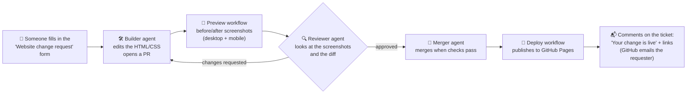

# company-website

**A company website that non-technical people change by filling in a form. AI agents make the edit,
review it with screenshots, merge it, deploy it, and tell the requester when it's live.**

🌐 **Live site:** https://rammanohar99.github.io/company-website/

The site belongs to *Brightleaf Interiors*, a fictional interior design studio. It's plain HTML and CSS in
[`site/`](site/), published to GitHub Pages.

---

## The flow

| Step | Who | What happens |
|---|---|---|
| 1. Request | A person | Fills in the [change request form](../../issues/new/choose): which page, what to change, in plain words |
| 2. Build | Builder agent | Checks the requester is allowed, edits `site/`, validates the HTML, opens a PR explaining the change in plain language |
| 3. Preview | GitHub Actions | Screenshots every changed page before and after, on desktop and mobile, and posts them on the PR |
| 4. Review | Reviewer agent | Looks at the screenshots and the diff and checks the request was actually met, then approves or sends it back |
| 5. Merge | Merger agent | Merges once the review is current and CI and Preview passed |
| 6. Deploy | GitHub Actions | Publishes `site/` to GitHub Pages |
| 7. Notify | GitHub Actions | After the deploy succeeds, comments on the original ticket with direct links to the updated pages |

The requester only ever touches the form and the final notification. If a request is unclear, the Builder
asks one plain-language question on the ticket instead of guessing.

## Asking for a change

1. Open **[Issues → New issue → Website change request](../../issues/new/choose)**.
2. Pick the page and describe the change in your own words. Exact new wording helps.
3. Wait for the "✅ Your change is live!" comment, usually within the hour.

> **Who can request changes:** anyone can submit the form, but the agents only act on requests from
> repository collaborators. Other requests are labelled `needs-triage` until a maintainer approves them
> with the `triage:approved` label. This stops strangers from changing a live website.

## How it's built

| Piece | File |
|---|---|
| Agent rules (labels, permissions, website rules) | [`AGENTS.md`](AGENTS.md) |
| Agent instructions | [`.agents/prompts/`](.agents/prompts/) (builder, reviewer, merger) |
| Runner the scheduler executes for each agent | [`automation/run_agent.py`](automation/run_agent.py) |
| Change request form | [`.github/ISSUE_TEMPLATE/website-change.yml`](.github/ISSUE_TEMPLATE/website-change.yml) |
| HTML validation and link check | [`.github/workflows/ci.yml`](.github/workflows/ci.yml) |
| Before/after screenshots on PRs | [`.github/workflows/preview.yml`](.github/workflows/preview.yml) |
| Deploy to Pages and notify the requester | [`.github/workflows/deploy.yml`](.github/workflows/deploy.yml) |

The agents are **Claude Code**, run on a schedule by
**[OpenHands Agent Canvas](https://github.com/OpenHands/OpenHands)** in Docker. They coordinate only through
GitHub labels, so every step is visible on the issue and PR. This is the same Builder → Reviewer → Merger
pattern as **[agent-pipeline-demo](https://github.com/rammanohar99/agent-pipeline-demo)**, which explains the
label state machine and has a full **[setup guide](https://github.com/rammanohar99/agent-pipeline-demo/blob/main/docs/SETUP.md)**.

Screenshots live on the `pr-previews` branch so they don't clutter `main`. Deploy links include `?v=<commit>`
so the requester sees the new version right away, without waiting for the Pages cache.

## Limitations

- **Content changes work best:** wording, contact details, prices, team members, new simple pages. Big
  redesigns or brand-new features still need a person.
- **The agents never invent facts** (prices, people, addresses). If the request doesn't include them, they ask.
- **Visual review is only as good as the screenshots:** they cover desktop and one phone size, not every browser.
- **Requests are handled about every 30 minutes,** while the machine running Agent Canvas is on.

## License

[MIT](LICENSE)
