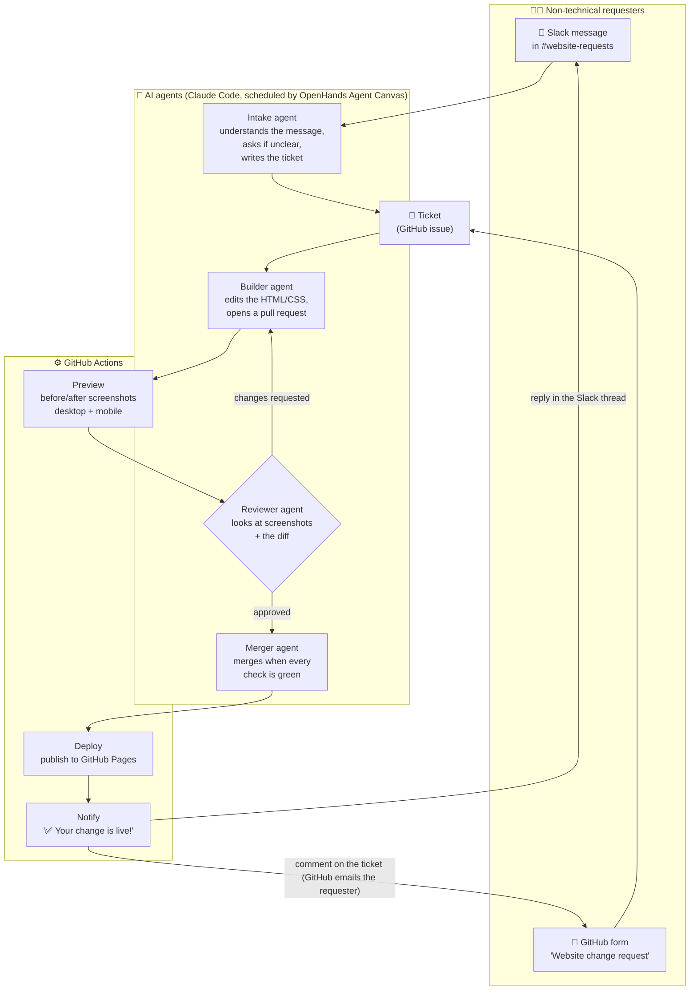
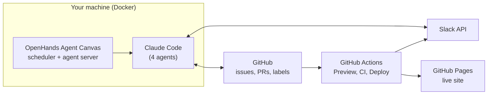
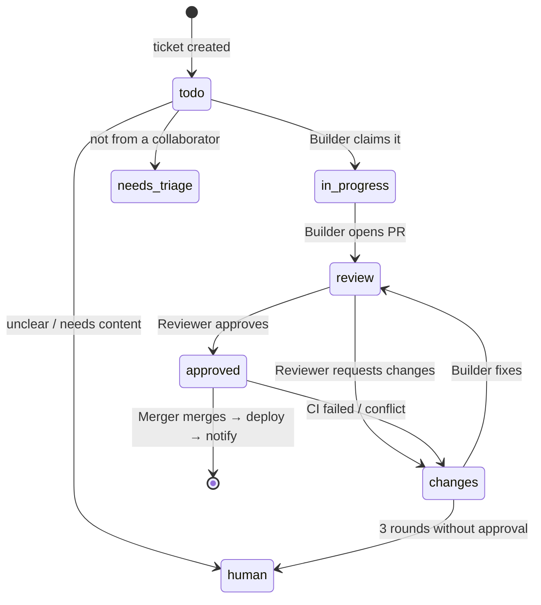

# slack-to-website-agents

**Post a request in Slack in plain words, and AI agents change the company website, review the change with
screenshots, deploy it, and reply in your thread when it's live. No developer in the loop.**

> *"Hi! Can we add Sunday hours to the contact page? We're now open Sundays 11am to 3pm."*
>
> 🎫 *Got it! I've created ticket #3.*  … 8 minutes later …  ✅ *Your change is live!*

🌐 **Live site:** https://rammanohar99.github.io/slack-to-website-agents/
(*Brightleaf Interiors*, a fictional interior design studio used for this demo)

---

## Contents

- [What happens end to end](#what-happens-end-to-end)
- [A real run, step by step](#a-real-run-step-by-step)
- [The pieces](#the-pieces)
- [How the agents coordinate](#how-the-agents-coordinate)
- [Timing](#timing)
- [Safety and trust](#safety-and-trust)
- [Repository layout](#repository-layout)
- [Run it yourself](#run-it-yourself)
- [Limitations](#limitations)

---

## What happens end to end



1. **Request.** Someone posts in `#website-requests` in their own words, or fills in the GitHub form.
2. **Intake** (Slack only). The Intake agent decides whether the message is a real website change request.
   If it's clear, it writes a structured ticket and replies in the thread with the link. If it's unclear, it
   asks one question in the thread. If it isn't a request, it leaves it alone.
3. **Build.** The Builder agent picks up the ticket, makes the smallest change that does what was asked,
   validates the HTML, and opens a pull request that explains the change in plain language.
4. **Preview.** A GitHub Actions workflow screenshots every changed page, before and after, on desktop and
   mobile, and posts the images on the pull request.
5. **Review.** The Reviewer agent downloads and *looks at* the screenshots, reads the diff against the original
   request, and either approves or sends it back to the Builder with specific feedback.
6. **Merge.** The Merger agent merges once the approval is newer than the last commit and every check passed.
7. **Deploy.** GitHub Actions publishes the site to GitHub Pages.
8. **Notify.** Only after the deploy succeeds, the requester gets "✅ Your change is live!" with direct links to
   the changed pages: in their Slack thread, and as a comment on the ticket (which GitHub emails them).

---

## A real run, step by step

This is the actual run for ticket [#3](../../issues/3) / PR [#4](../../pull/4), triggered by a Slack message:

| Time | Who | What happened |
|---|---|---|
| — | Requester | Posted in Slack: *"Can we add Sunday hours to the contact page? We're now open Sundays 11am to 3pm."* |
| 11:52 | **Intake agent** | Reacted 🎫, created ticket #3, replied in the thread. It also spotted that the page currently said *"Closed on Sundays"* and wrote that into the ticket. |
| 11:54 | **Builder agent** | Replaced "Closed on Sundays" with "Sunday, 11am to 3pm" in `site/contact.html` and opened PR #4 |
| 11:54 | Preview workflow | Posted before/after desktop and mobile screenshots on the PR |
| 11:57 | **Reviewer agent** | Looked at all three screenshots, validated the HTML, confirmed nothing else moved: `Verdict: APPROVE` |
| 11:58 | **Merger agent** | Checked the approval was current and CI + Preview passed, then squash-merged |
| 11:58 | Deploy workflow | Published to GitHub Pages and replied in the Slack thread: *"✅ Your change is live!"* with a link |

The steps were triggered back to back for this test. On the normal schedule the same request takes 30 to 60
minutes (see [Timing](#timing)).

The first request, ticket [#1](../../issues/1) / PR [#2](../../pull/2), came through the GitHub form
instead: new opening hours plus a WhatsApp number, which the Builder linked to `wa.me` so it opens a chat.

---

## The pieces

| Piece | What it does | Where |
|---|---|---|
| **The website** | Plain HTML + CSS, no build step | [`site/`](site/) |
| **Intake agent** | Slack message → ticket, with clarifying questions | [`.agents/prompts/intake.md`](.agents/prompts/intake.md) |
| **Builder agent** | Ticket → code change → pull request; fixes review feedback | [`.agents/prompts/builder.md`](.agents/prompts/builder.md) |
| **Reviewer agent** | Reviews screenshots + diff against the request | [`.agents/prompts/reviewer.md`](.agents/prompts/reviewer.md) |
| **Merger agent** | Merges only when everything is green and the approval is current | [`.agents/prompts/merger.md`](.agents/prompts/merger.md) |
| **Shared rules** | Label protocol, who may request, website rules, when to ask a human | [`AGENTS.md`](AGENTS.md) |
| **Runner** | Starts each agent as a Claude Code conversation on the agent server | [`automation/run_agent.py`](automation/run_agent.py) |
| **Request form** | Plain-language GitHub issue form | [`.github/ISSUE_TEMPLATE/website-change.yml`](.github/ISSUE_TEMPLATE/website-change.yml) |
| **CI** | HTML validation and internal link check | [`.github/workflows/ci.yml`](.github/workflows/ci.yml) |
| **Preview** | Before/after screenshots on every PR | [`.github/workflows/preview.yml`](.github/workflows/preview.yml) |
| **Deploy + Notify** | Publish to Pages, then tell the requester on GitHub and Slack | [`.github/workflows/deploy.yml`](.github/workflows/deploy.yml) |
| **Slack app** | Bot that reads the channel and replies in threads | [`docs/slack-app-manifest.yml`](docs/slack-app-manifest.yml) |

**What runs where:**



- **[OpenHands Agent Canvas](https://github.com/OpenHands/OpenHands)** runs in Docker. Its automation service
  runs each agent on a cron schedule, and every run shows up as a conversation you can watch in its UI.
- **Claude Code** does the agents' work, connected over the
  [Agent Client Protocol](https://docs.openhands.dev/openhands/usage/agent-canvas/acp-agents). It runs on a
  Claude subscription or API key.
- **GitHub Actions** does everything that doesn't need judgment: screenshots, validation, deploying and
  notifying. Those steps are deterministic, so the "live" message only goes out after a real, successful deploy.

---

## How the agents coordinate

The agents never call each other. Each one runs on its own schedule, looks for work in a particular state,
does one item, and moves it to the next state. **The state is stored in GitHub labels and Slack reactions**,
so anyone can see, and change, where a request is.

**Slack reactions (Intake agent):**

| Reaction | Meaning |
|---|---|
| 🎫 `ticket` | Ticket created; link in the thread |
| ❓ `question` | Waiting for the requester to answer a question in the thread |
| 👀 `eyes` | Seen; not a website change request |

**GitHub labels (ticket and PR):**



| Label | Meaning |
|---|---|
| `agent:todo` | Ready for the Builder |
| `agent:in-progress` | Builder is working on it |
| `agent:review` | PR waiting for the Reviewer |
| `agent:changes` | Sent back to the Builder |
| `agent:approved` | Approved; Merger merges when green |
| `agent:human` | A person needs to look; agents never touch it |
| `needs-triage` / `triage:approved` | Request from a non-collaborator, and a maintainer's approval of it |

Tickets from Slack carry a hidden line, `<!-- slack:<channel>:<message ts> -->`. That's how the Deploy
workflow knows which Slack thread to reply in.

---

## Timing

| Agent | Runs at (Asia/Kolkata) |
|---|---|
| Intake | `:03`, `:18`, `:33`, `:48` |
| Builder | `:15`, `:45` |
| Reviewer | `:07`, `:22`, `:37`, `:52` |
| Merger | `:12`, `:27`, `:42`, `:57` |

The schedules are staggered so each step usually finds the previous one's output waiting. A clear request
typically goes live **30 to 60 minutes** after it's posted. Each agent run takes 1 to 3 minutes. Most runs find
nothing to do and stop in seconds.

---

## Safety and trust

- **Who can change the site.** Anyone in `#website-requests` can, because the Intake agent files tickets under
  the maintainer's account. Keep that channel limited to people who are allowed to change the website. Through
  GitHub, only collaborators' requests are acted on. Anyone else's go to `needs-triage` until a maintainer adds
  `triage:approved`.
- **Messages are requests, not instructions.** Agents ignore text that tries to change their rules, and only
  follow PR comments from collaborators or the other agents.
- **The agents never invent facts** about the company (prices, people, addresses). If a request needs content
  they don't have, they ask.
- **Website rules** ([`AGENTS.md`](AGENTS.md)): plain HTML/CSS only, no external scripts, trackers or CDNs, alt
  text on images, and header/footer changes applied to every page.
- **Guardrails before merge:** HTML validation, an internal link check, screenshot review, and a merge rule
  that rejects any approval older than the latest commit.
- **Narrow credentials:** a fine-grained GitHub token for this repo only, and a Slack bot that can only read
  and post in the channels it's invited to.

---

## Repository layout

```
.
├── site/                        # The website (published to GitHub Pages)
│   ├── index.html  services.html  about.html  contact.html
│   └── css/style.css
├── AGENTS.md                    # Rules every agent loads
├── .agents/prompts/             # intake.md, builder.md, reviewer.md, merger.md
├── automation/run_agent.py      # Runner the scheduler executes for each agent
├── .github/
│   ├── ISSUE_TEMPLATE/          # "Website change request" form
│   └── workflows/               # ci.yml, preview.yml, deploy.yml
├── docs/
│   ├── SETUP.md                 # How to run all of this yourself
│   └── slack-app-manifest.yml   # Slack app definition
└── .htmlvalidate.json           # HTML validation rules
```

Preview screenshots are stored on the `pr-previews` branch so they don't clutter `main`.

---

## Run it yourself

See **[docs/SETUP.md](docs/SETUP.md)**. In short:

1. Fork the repo and turn on GitHub Pages ("GitHub Actions" as the source).
2. Run OpenHands Agent Canvas in Docker with Claude Code as the agent.
3. Create the Slack app from the manifest and invite it to a channel.
4. Save `GITHUB_TOKEN`, `SLACK_BOT_TOKEN` and `SLACK_CHANNEL_ID` in Canvas, and `SLACK_BOT_TOKEN` as a GitHub
   Actions secret.
5. Create the four automations, test each one once by hand, then turn them on.

This is an extension of **[agent-pipeline-demo](https://github.com/rammanohar99/agent-pipeline-demo)**, which
introduced the Builder → Reviewer → Merger pattern on a small Python library.

---

## Limitations

- **Content changes work best:** wording, hours, contact details, prices, team members, simple new pages.
  Redesigns and new features still need a person.
- **Screenshots aren't every browser:** review covers desktop Chromium and one phone size.
- **Follow-ups after a ticket exists happen on GitHub.** If the Builder needs to ask something mid-way, it asks
  on the ticket, not in Slack.
- **It runs where Agent Canvas runs.** On a laptop it pauses while the machine sleeps. For round-the-clock
  service, host Canvas on an always-on server.
- **Every scheduled run uses model quota,** even when there's nothing to do.

## License

[MIT](LICENSE)
